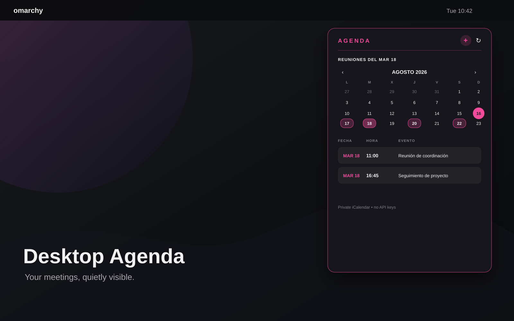

# Desktop Agenda para Omarchy

[English](README.md)

Agenda de escritorio para Omarchy Quattro: muestra tus próximas reuniones directamente sobre el escritorio, debajo de la barra superior, sin abrir una aplicación de calendario ni usar una API del proveedor.



Funciona con cualquier servicio que publique un feed iCalendar (`.ics`): Google Calendar, Nextcloud, Fastmail, calendarios institucionales o un servidor propio.

## Qué resuelve

- Próximas reuniones siempre visibles cuando estás en el escritorio.
- Una vista compacta para no llenar la pantalla.
- Un calendario mensual para orientarte rápidamente.
- Filtro por día: puedes ver solo las reuniones de una fecha.
- Varios calendarios en una sola agenda.
- Enlaces de Zoom, Google Meet y otros eventos abiertos con un clic.
- Sin cuentas nuevas, API keys, OAuth ni servidor intermedio.

## Instalación

Requiere Omarchy Quattro, Quickshell y Python 3.9 o superior.

```bash
omarchy plugin add https://github.com/brm-src/omarchy-calendar-agenda.git --enable --yes
bash ~/.config/omarchy/plugins/io.github.brm-src.calendar-agenda/configure-calendar.sh
```

El asistente te pide una o más URL privadas iCalendar y un nombre para cada calendario. Pulsa Enter con la URL vacía cuando termines.

El asistente:

- comprueba que cada URL use HTTPS;
- verifica que el servidor entregue un calendario iCalendar real;
- guarda la configuración con permisos `600`;
- reinicia el shell de Omarchy para mostrar la agenda.

No instala paquetes ni ejecuta código descargado desde Internet.

Para revisar el código antes de activarlo:

```bash
omarchy plugin add https://github.com/brm-src/omarchy-calendar-agenda.git --yes
omarchy plugin enable io.github.brm-src.calendar-agenda
```

## Cómo configurarlo

### Google Calendar

1. Abre Google Calendar.
2. Pulsa el engranaje → **Configuración**.
3. En la izquierda, selecciona el calendario que quieres mostrar.
4. Baja hasta **Integrar el calendario**.
5. Copia **Dirección secreta en formato iCal**.
6. Pega esa URL cuando la pida `configure-calendar.sh`.

La URL debe terminar normalmente en `/basic.ics`. No uses el enlace de la página de Google Calendar ni la dirección pública si el calendario es privado.

### Varios calendarios

Ejecuta otra vez el asistente y agrega todos los feeds que quieras:

```bash
bash ~/.config/omarchy/plugins/io.github.brm-src.calendar-agenda/configure-calendar.sh
```

La configuración queda en `~/.config/omarchy/calendar-widget/config.json` con este formato:

```json
{
  "calendars": [
    {"name": "Trabajo", "icalUrl": "https://ejemplo/trabajo.ics"},
    {"name": "Personal", "icalUrl": "https://ejemplo/personal.ics"}
  ]
}
```

También se acepta el formato antiguo de un solo calendario con `icalUrl`.

## Cómo funciona la interfaz

La tarjeta aparece en la esquina superior derecha del escritorio, debajo de la barra. Cuando hay una ventana activa, se oculta completamente para no superponerse ni filtrarse a través de terminales translúcidos.

- **`+`**: expande la agenda y muestra el calendario mensual.
- **`−`**: vuelve a la vista compacta.
- **`↻`**: actualiza todos los feeds inmediatamente.
- **Día con reuniones**: haz clic para filtrar la lista y ver solo las reuniones de ese día.
- **Día seleccionado**: vuelve a hacer clic para quitar el filtro.
- **Día sin reuniones**: abre Google Calendar directamente en esa fecha para crear un evento.
- **Fila de una reunión**: abre el enlace detectado del evento, priorizando Zoom o Google Meet.
- **Eventos de todo el día**: aparecen identificados sin inventar una hora.

La vista compacta muestra los próximos cuatro eventos. La vista expandida muestra hasta ocho y el calendario del mes.

## Privacidad y seguridad

El plugin no usa API de proveedor, OAuth, client secrets ni una credencial compartida. Tu equipo descarga directamente los feeds que tú configuras.

Una URL privada iCalendar funciona como una contraseña: quien la obtenga puede leer ese calendario. Por eso:

- usa únicamente URL `https://`;
- no publiques la URL en issues, capturas ni repositorios;
- si se filtra, regénérala en el servicio de calendario;
- la configuración local se guarda con permisos `600`.

Comprueba los permisos con:

```bash
stat -c '%a %n' ~/.config/omarchy/calendar-widget/config.json
```

La salida esperada es `600`.

## Solución de problemas

### No aparecen eventos

1. Comprueba que el feed esté configurado:

   ```bash
   python3 ~/.config/omarchy/plugins/io.github.brm-src.calendar-agenda/calendar_events.py
   ```

2. Si ves un error de configuración, vuelve a ejecutar:

   ```bash
   bash ~/.config/omarchy/plugins/io.github.brm-src.calendar-agenda/configure-calendar.sh
   ```

3. Si el evento está fuera de los próximos 30 días, no aparecerá todavía.
4. Si la URL dejó de funcionar, genera una nueva URL secreta en tu proveedor.

### La agenda no se ve

La agenda está debajo de las ventanas a propósito. Minimiza o cierra las aplicaciones para volver al escritorio limpio.

### El feed cambió y la agenda no se actualizó

Pulsa `↻`. La actualización automática ocurre cada cinco minutos.

## Desinstalación

Elimina el plugin y su configuración local:

```bash
bash ~/.config/omarchy/plugins/io.github.brm-src.calendar-agenda/configure-calendar.sh --remove
omarchy plugin remove io.github.brm-src.calendar-agenda --yes
```

Esto no borra eventos remotos ni modifica tu cuenta de calendario.

## Desarrollo y validación

```bash
python3 -m unittest discover -s tests -v
python3 -m py_compile calendar_events.py
qmllint -I /usr/share/omarchy/shell CalendarAgenda.qml
omarchy plugin validate .
bash -n configure-calendar.sh
git diff --check
```

## Marketplace

Desktop Agenda es un plugin de productividad para Omarchy: pequeño, local, sin API propietaria y compatible con cualquier feed iCalendar HTTPS. La lista del marketplace no reemplaza la revisión del código fuente; los plugins de Omarchy se ejecutan sin sandbox.

## Licencia

MIT. Consulta [LICENSE](LICENSE).
