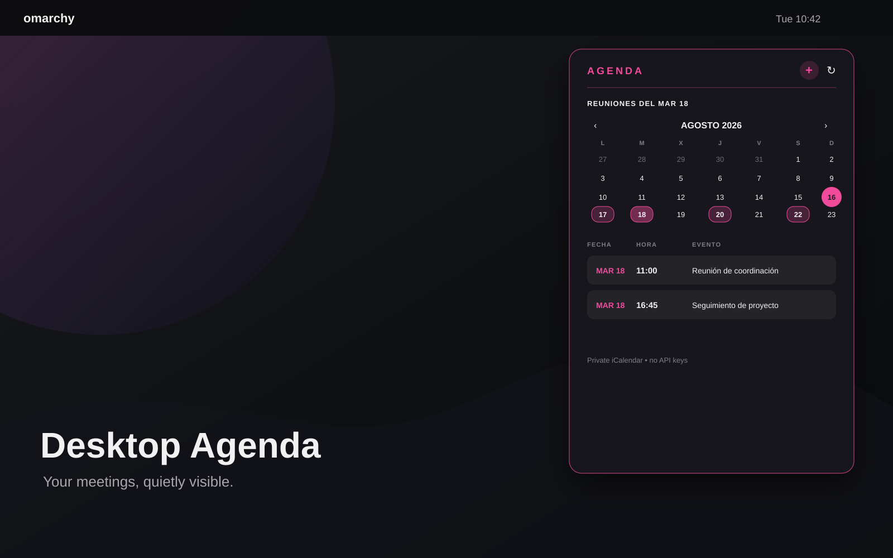

# Desktop Agenda for Omarchy

[Español](README.es.md)

A quiet desktop overlay for Omarchy Quattro. It shows upcoming events in a small card below the top bar.



It works with any service that exposes an iCalendar (`.ics`) URL: Google Calendar, Nextcloud, Fastmail, self-hosted calendars, and more.

## Quick install

Requires Omarchy Quattro, Quickshell, Python 3.9+, and a private `https://` `.ics` URL.

```bash
omarchy plugin add https://github.com/brm-src/omarchy-calendar-agenda.git --enable --yes
bash ~/.config/omarchy/plugins/io.github.brm-src.calendar-agenda/setup.sh
```

The second command asks for the private HTTPS URL, verifies that it is an iCalendar feed, stores it locally with mode `600`, and restarts the Omarchy shell. It installs no packages and does not execute code downloaded from another URL.

To review the source before enabling it, omit `--enable` in the first command and run:

```bash
omarchy plugin enable io.github.brm-src.calendar-agenda
```

## Usage

The card appears in the upper-right corner and refreshes every five minutes. It shows up to eight events in the next 30 days.

- Today is labelled `HOY`.
- Tomorrow is labelled `MAÑANA`.
- Events are ordered by start time.
- Clicking an event opens its link with the desktop default browser.
- Google Meet and Zoom links found in descriptions are preferred.

## Privacy: no API keys

The plugin uses no vendor API, OAuth client, client secret, or shared credential. Each person configures their own private iCalendar URL in:

```text
~/.config/omarchy/calendar-widget/config.json
```

A private calendar URL is a bearer secret: anyone who obtains it may read the calendar. Use HTTPS so the URL is not sent in plaintext. Do not publish it or paste it into issues, screenshots, or logs.

The repository contains no credentials and events are never sent through a third-party proxy. The local machine fetches the feed directly.

## Troubleshooting

If the card says the calendar is not configured:

```bash
bash ~/.config/omarchy/plugins/io.github.brm-src.calendar-agenda/setup.sh
```

To check the local file and permissions:

```bash
stat -c '%a %n' ~/.config/omarchy/calendar-widget/config.json
```

The expected mode is `600`.

## Uninstall

This removes the plugin and its local configuration. It does not touch the remote calendar or account:

```bash
bash ~/.config/omarchy/plugins/io.github.brm-src.calendar-agenda/setup.sh --remove
```

## Development and validation

```bash
python3 -m unittest discover -s tests -v
omarchy plugin validate .
qmllint -I "$OMARCHY_PATH/shell" CalendarAgenda.qml
```

## License

MIT. See [LICENSE](LICENSE).
